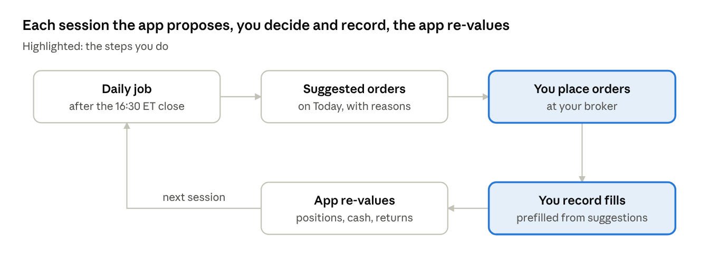
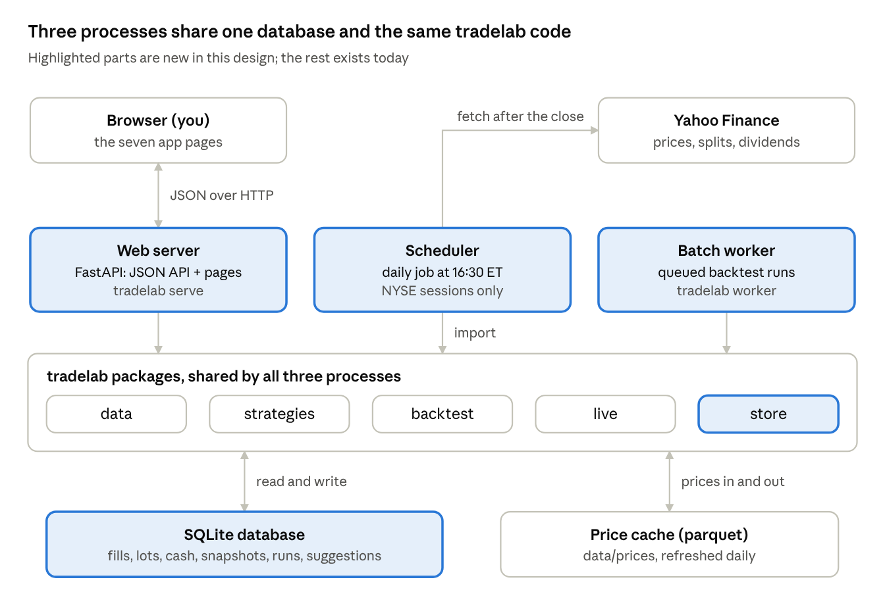
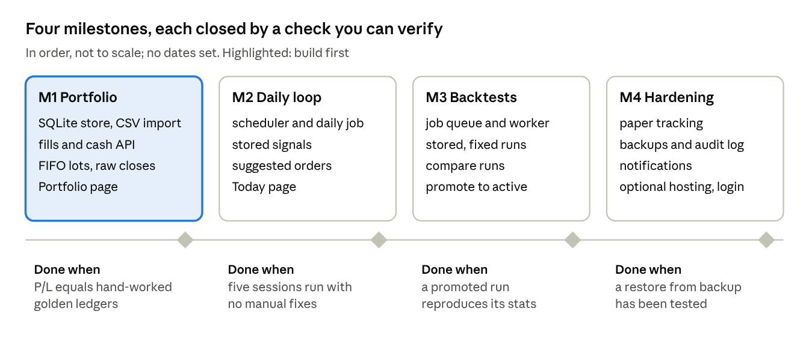

# tradelab Web App — Design

**Date:** 2026-10-11 · **Status:** approved as the phase 1 design · **Live doc:** [tradelab Web App — Design](https://claude.ai/code/artifact/9a0a0e69-bd6b-4ee2-ae30-5316794abe82) (this file is a snapshot of it)

## Summary

tradelab becomes a single-user web app that remembers your portfolio, values it after every close, runs backtests as batch jobs, and turns one promoted strategy into a daily list of suggested orders. It is built on the existing Python packages; the new parts are a database, a web server, a scheduler and a batch worker.

| You asked for | How the design does it |
| --- | --- |
| A permanent, stateful website | A web server that stays up, with a SQLite database as the single source of truth |
| It memorises my portfolio | Every fill and cash movement is stored; positions and tax lots are derived from them |
| It computes P&L and shows it on a dashboard | A daily valuation writes one snapshot per session; the Today and Portfolio pages read them |
| Backtests are batch | Each backtest is a queued job whose results are stored and never change |
| It integrates a particular strategy | You promote one backtest run to "active", which pins its strategy and parameters |
| It suggests what to do | After each close, the active strategy's target is compared with your holdings to produce suggested orders |

**Not in version 1**

- No broker connection or order execution: you place orders yourself and record the fills.
- No intraday data: decisions use daily closes and assume fills at the next open, as the backtests do.
- Suggestions are the mechanical output of the strategy you chose, not investment advice.
- One user, one account.

## User flows

The app runs one loop every trading day: the system proposes orders after the close, you trade and record what you did, and the app re-values the portfolio from your records.



The app never trades: the two highlighted steps are the only ones that change your positions.

**Daily check (every session, after 16:30 ET)**

1. The daily job has already fetched prices, recomputed every strategy and written suggested orders for the next open.
2. You open Today: data status, portfolio value, day and total P&L, then the suggested orders with the reason for each.
3. You place the orders you agree with at your broker.
4. You record each fill from its suggestion; the form is prefilled with symbol, side and quantity, and you type the actual price and fees.
5. Suggestions you don't act on can be dismissed; the rest expire at the next run.

**Recording a fill or a cash movement (any time)**

1. Enter date, side, symbol, quantity, price, fees and an optional strategy tag (the active strategy when recorded from a suggestion).
2. The app rejects a sell larger than your holding and a date in the future.
3. Positions, lots and P&L recompute at once; a back-dated fill recomputes snapshots from that date.
4. Edits and deletes are kept in an audit log, never silent.

**Backtest, compare, promote**

1. Pick a strategy, parameters, period and cost model, or a parameter grid, and submit.
2. The batch worker runs it; the run page shows full-period, in-sample and out-of-sample stats, curves and cost sensitivity.
3. Compare runs side by side.
4. Promote a run to active. Before confirming, the app shows the target it would hold today and the orders that would follow.

**Review**

- Portfolio: P&L history against QQQ, positions, lots, realized P&L, the fill ledger.
- Strategy: your real portfolio against a paper portfolio that follows the active strategy exactly, and the share of suggestions you acted on.

## Architecture

Three long-running processes share one SQLite database on one machine: the web server, the scheduler and the batch worker. All three import the existing tradelab packages, so the backtests, signals and app use the same code.



You only talk to the web server; the scheduler and worker write their results to the same database the pages read.

| Concern | Choice | Why |
| --- | --- | --- |
| API and pages | FastAPI + Uvicorn | Python, so it imports tradelab directly; typed request and response models |
| Database | SQLite in WAL mode, SQLAlchemy 2, Alembic migrations | One user, no server to run, backup is a file copy; move to Postgres only if hosted for several users |
| Bulk price history | The existing parquet cache in `data/prices` | Already built and fast; long time series stay out of SQL |
| Scheduler | A small process using APScheduler, gated by the NYSE calendar | Runs the daily job at 16:30 ET and catches up missed sessions |
| Batch worker | `tradelab worker` polling a jobs table | No Redis or Celery for one user; every job stays visible and restartable |
| Front end | The current templates and Plotly charts, served by the API and fetching JSON; HTMX for forms | Reuses the three pages already built; no JavaScript build step |

**Package layering**, extending the rule the codebase follows today:

- Existing logic: `data`, `strategies`, `backtest`, `live`. Unchanged; still no printing and no presentation imports.
- New `store`: database models and repositories (fills, lots, snapshots, runs, suggestions). Imports logic packages only.
- New `jobs`: the daily pipeline and the backtest worker. Calls logic, writes through `store`.
- New `api`: FastAPI routers. Reads and writes through `store`, triggers `jobs`.
- `dashboard` becomes `web`: templates and static files. It fetches from the API instead of having data baked into the HTML.
- `cli` stays the operator's entry point (`tradelab serve`, `tradelab worker`, `tradelab daily`).

## Data model

Fills and cash flows are the only facts you enter; everything else (lots, snapshots, suggestions) is derived from them and can be rebuilt. Valuation uses raw (unadjusted) closes plus corporate actions, because the adjusted prices used for research change retroactively after every dividend.

| Table | Key columns | Notes |
| --- | --- | --- |
| `fills` | id, trade_date, side, symbol, qty, price, fees, strategy_id, suggestion_id, note, created_at, deleted_at | Source of truth; soft delete only |
| `cash_flows` | id, date, kind (deposit, withdrawal, dividend, fee, interest), amount, symbol, note | Dividends are created by the daily job from corporate actions |
| `lots` | id, open_fill_id, symbol, open_date, qty_open, qty_remaining, cost_per_share | Derived from fills (FIFO); rebuilt on any fill edit |
| `corporate_actions` | symbol, ex_date, pay_date, kind (split, dividend), ratio, amount_per_share | From Yahoo; splits rescale lots, dividends post cash |
| `raw_closes` | symbol, date, close | Unadjusted closes for valuation; research keeps the adjusted parquet cache |
| `portfolio_snapshots` | date, market_value, cash, net_flows, realized_cum, unrealized, day_pnl, twr_index | One row per session; drives the P&L chart |
| `strategy_configs` | id, strategy_name, params_json, code_sha | A strategy with its parameters pinned |
| `active_strategy` | config_id, promoted_from_run, capital_mode, capital, min_order_usd, activated_at | One row: what drives suggestions |
| `backtest_runs` | id, config_id, start, end, split, costs_json, execution, data_as_of, code_sha, status, timestamps, error | One per submitted job; a sweep is one run per grid point |
| `backtest_results` | run_id, stats_by_period_json, annual_json, cost_sensitivity_json, equity_path | Equity curve stored as a parquet file beside the database |
| `targets` | date, config_id, symbol, weight, score | Every strategy's target after each close |
| `suggestions` | id, signal_date, for_session, symbol, action, qty, ref_price, target_weight, reason, status, filled_qty | Status: open, done, partial, dismissed, expired |
| `paper_snapshots` | date, config_id, equity, positions_json | The active strategy followed exactly from its activation date |
| `job_runs` | id, kind, params_json, status, started_at, finished_at, log_tail | Daily runs and backtests; shown in the UI |
| `audit_log` | ts, entity, entity_id, action, before_json, after_json | Every change to fills, cash and the active strategy |

The current CSV ledger (`data/portfolio/trades.csv`) is imported once into `fills` by a migration script.

## Portfolio and P&L engine

P&L is recomputed from the fills, cash flows and raw closes, never stored as a running total, so a corrected fill fixes every number after it. The engine is pure Python in `live.portfolio`, with no database code, so it can be tested against hand-worked fixtures.

- **Lots:** first-in, first-out, matching how US brokers report cost basis. Realized P&L on a sell = proceeds − FIFO cost of the lots closed − fees. The current code uses average cost; the switch is listed under open decisions.
- **Splits:** on the ex-date, each open lot's quantity is multiplied by the ratio and its cost per share divided by it; total cost is unchanged.
- **Dividends:** credited as cash on the pay date (shares held on the ex-date × amount) and counted as income.
- **Unrealized P&L:** Σ (raw close − cost per share) × remaining quantity, over open lots.
- **Equity:** market value of positions + cash. Cash = deposits − withdrawals − buys + sells + dividends − fees.

Daily P&L removes the effect of money you add or take out, and the time-weighted return chains those daily returns (external flows are assumed to arrive at the start of the day):

```latex
\mathrm{PnL}_t = E_t - E_{t-1} - F_t \qquad r_t = \frac{\mathrm{PnL}_t}{E_{t-1} + F_t} \qquad \mathrm{TWR}_t = \prod_{s \le t} (1 + r_s)
```

where E is equity at the close and F is net external cash flow on that day.

- **Benchmark:** QQQ's total return over the same sessions; the dashboard shows the gap.
- **Without cash records**, return on invested capital is still shown, but time-weighted return needs deposits and withdrawals (open decision).
- **Checks:** realized + unrealized + dividends − account fees = equity − net deposits, asserted on every snapshot (trade fees are already inside cost basis and proceeds); golden ledgers with known answers in the test suite.

## Active strategy and suggested actions

Suggested orders are the difference between the active strategy's target, in shares, and what you hold for that strategy; nothing else generates them. Version 1 supports one active strategy; blending several with allocations is a later step.

**Inputs after each close**

- Target weights from `live.signals` for the pinned config (the same code the backtests run).
- Your holdings tagged to the active strategy, from the lots. Positions tagged `manual` or another strategy are never touched.
- Capital: a fixed dollar amount, or a percentage of portfolio equity (open decision).
- Reference price: that session's close. The order is for the next open, so the fill will differ.

**Sizing rules**

1. Orders are produced only on the strategy's rebalance day (last session of the week or month), plus any exits the rules trigger daily.
2. Target shares = floor(weight × capital ÷ close), or fractional if your broker supports it.
3. Order quantity = target shares − held shares; sells are listed before buys.
4. Orders below a minimum value (default $100) are skipped, so drift doesn't create tiny trades.
5. When cash is tracked and buys exceed it, all buys are scaled down by the same factor.
6. If price data is stale or failed validation, no suggestions are produced and Today says why.

**What each suggestion carries:** action, symbol, quantity, reference price, target weight, and a reason from the strategy's score (for example "SELL: fell below its 200-day average, −3.8%" or "BUY: enters the top 20% on 12-1 return, +45%").

**Lifecycle:** open → done when linked fills cover the quantity, partial when they cover some of it, dismissed by you, or expired at the next run. A fill recorded from a suggestion is linked to it; a fill entered separately is matched by symbol and side on the next session.

**Paper tracking:** from the day a strategy is promoted, the app also follows it exactly on paper, with the backtest's fill and cost assumptions and your capital setting. Comparing paper with real equity shows what slippage, skipped orders and timing cost you; adherence is the share of suggestions you acted on.

## Batch backtests

A backtest is a job you submit, not a page you load: it runs in the worker, its results are stored once, and a run never changes afterwards, so a promoted strategy can always be traced to the evidence behind it.

1. **Submit** from the Backtests page or `tradelab backtest submit`: strategy, parameters (or a grid), start date, in/out-of-sample split, cost model, fill assumption.
2. **Queue:** a `backtest_runs` row with status queued; one row per grid point for a sweep.
3. **Run:** the worker claims the oldest queued run and calls the existing `backtest.runner` and `backtest.analysis`, so results match today's report and backtest page.
4. **Store:** stats per period, calendar-year returns, cost sensitivity and the equity curve; status done or failed with the error.
5. **Compare:** the current backtest page, fed from stored runs; pick any runs to overlay.
6. **Promote:** pins the run's strategy and parameters as a new config and makes it active from the next daily run. The confirm dialog shows out-of-sample stats and the 20 bps cost line next to the full-period numbers, because a sweep's best row is usually the luckiest.

**Reproducibility:** each run records the code's git commit, the last price date it used and a fingerprint of the price files. The price cache is refreshed daily, so an exact rerun needs a snapshot; the worker can copy the cache into `data/snapshots/<date>/` when a run is promoted (open decision on how many to keep).

## Daily pipeline

The scheduler runs one job at 16:30 ET on every NYSE session. It stops at the first failed check, leaving the previous session's numbers in place, rather than producing suggestions from bad data.

1. **Fetch:** constituents, adjusted history, raw closes and corporate actions for the universe, QQQ and anything you hold outside the index; retried three times with backoff.
2. **Validate:** the last bar must be the session that just closed; gaps, missing symbols and single-day moves over 50% are flagged. A failure ends the job and puts a banner on Today.
3. **Corporate actions:** apply splits to open lots and post dividends to cash.
4. **Signals:** every registered strategy, stored in `targets` (this also feeds the Signals and Screener pages).
5. **Suggestions:** for the active strategy; the previous session's open suggestions expire.
6. **Value:** write the portfolio snapshot and the paper-strategy snapshot.
7. **Notify (optional):** a short summary with the number of orders, day P&L, exits on your holdings and any warnings.

- **Idempotent:** outputs are keyed by session date; re-running a date replaces that date's outputs and never touches fills.
- **Catch-up:** if the machine was asleep, the scheduler runs missed sessions in order when it wakes.
- **Manual run:** a "Run now" button and `tradelab daily` run the same job.

## API

A JSON REST API under `/api` backs every page and is the only way the browser changes state. Request and response models are typed (Pydantic), and OpenAPI docs are served at `/docs`.

| Method and path | Purpose |
| --- | --- |
| `GET /api/today` | Data status, latest snapshot, open suggestions, alerts |
| `GET /api/portfolio` | Positions, lots, totals, realized P&L |
| `GET /api/portfolio/history?from=` | Snapshots for the P&L chart, with QQQ alongside |
| `GET` `POST /api/fills` | List or record fills (validated: no overselling, no future dates) |
| `PATCH` `DELETE /api/fills/{id}` | Correct or remove a fill; audited, recomputes from its date |
| `GET` `POST /api/cash` | Deposits, withdrawals, dividends, fees |
| `GET /api/suggestions?date=` | Suggested orders for a session |
| `POST /api/suggestions/{id}/fill` | Record a fill linked to a suggestion |
| `POST /api/suggestions/{id}/dismiss` | Dismiss a suggestion |
| `GET /api/strategies` | Registry strategies and pinned configs |
| `GET /api/signals?date=&strategy=` | Every strategy's target and changes after a close |
| `GET` `PUT /api/active-strategy` | Show or change the active config, capital and minimum order size |
| `POST /api/backtests` | Submit a run or a parameter grid |
| `GET /api/backtests`, `GET /api/backtests/{id}` | Run list and one run's stored results |
| `POST /api/backtests/{id}/promote` | Pin the run's config and make it active |
| `GET /api/jobs`, `POST /api/jobs/daily` | Job history and logs; run the daily job now |
| `GET /api/screener`, `GET /api/prices/{symbol}?range=` | Screener table and chart series |

## UI

Seven pages share one navigation bar and the existing look (light and dark themes, the validated colour palette). Today is the home page, because the daily decision is the main reason to open the app.

| Page | Shows | You can |
| --- | --- | --- |
| Today | Data status; equity, day P&L, total P&L, return against QQQ; suggested orders for the next open with reasons; exit signals on your holdings | Record a fill from a suggestion, dismiss a suggestion, run the daily job |
| Portfolio | Positions (quantity, cost, last close, value, P&L, weight against target); P&L and drawdown history against QQQ; lots; fill ledger; cash | Add, correct or delete a fill; add a cash flow; export CSV |
| Strategy | Active strategy, parameters and schedule; today's target; next rebalance date; paper against real equity; adherence | Change capital and minimum order size; deactivate |
| Backtests | Run list with status; run detail (the current comparison page); side-by-side comparison | Submit a run or grid; promote a run |
| Signals | Every strategy's targets and changes for any recent session (the current signals page) | Browse past sessions |
| Screener | Screener table, filters and indicator charts (the current screener page) | Keep a watchlist, now stored in the database |
| Settings and jobs | Capital mode, minimum order, fractional shares, schedule time, notifications; job history with logs | Run a job, read a failure |

## Non-functional

The default is a private app on your Mac, reachable only from that machine. Everything below that changes if it is hosted is marked.

- **Hosting:** launchd keeps `tradelab serve`, `tradelab worker` and the scheduler running and restarts them after a crash or reboot. The server binds to 127.0.0.1. Phone access, if wanted, goes through a private network such as Tailscale rather than an open port. Hosted alternative: one small container with a persistent volume for the database.
- **Authentication:** none on localhost. If hosted: a single-user login (argon2-hashed password, session cookie), HTTPS only, CSRF protection on forms.
- **Backups:** a nightly SQLite online backup to `data/backups/` (keep 30), plus an optional off-machine copy; fills can always be exported as CSV.
- **Audit:** fills and cash flows are soft-deleted only; every change is in `audit_log` with before and after values.
- **Privacy:** the database and ledger live in `data/`, which git ignores.
- **Testing:** golden-ledger fixtures for the P&L engine; sizing and lifecycle tests for suggestions; API tests through FastAPI's test client; a test that re-running the daily job for a date is idempotent; the existing lookahead tests; output snapshots diffed before and after refactors.
- **Observability:** every job writes a `job_runs` row with a log tail shown in the UI; `/api/health` reports the last successful daily run and the data's last date.

## Risks and caveats

The biggest risks are wrong P&L from wrong prices and trusting backtests too much; the design guards both but cannot remove them.

| Risk | Effect | Mitigation |
| --- | --- | --- |
| Yahoo data is unofficial and can be late, missing or wrong | Bad valuation or bad suggestions | Validation step; stale banner; no suggestions from failed data; a paid source later |
| Adjusted prices used for valuation | P&L shifts after every dividend | Valuation on raw closes plus corporate actions; adjusted data only for research |
| Survivorship bias (today's members applied to the past) | Backtests overstate returns | Compare against the equal-weight universe; point-in-time membership data later |
| Promoting the best row of a sweep | Live results fall short of the backtest | Promote shows out-of-sample and cost-stressed stats; paper tracking exposes the gap early |
| Suggestions read as advice | Decisions without judgement | Labelled as the chosen strategy's mechanical output; you place every order |
| Long-short strategies | Need margin and borrow the app doesn't model | Only long-only strategies can be promoted in version 1 |
| Machine asleep at 16:30 ET | Late or missing suggestions | Catch-up run on wake; Today shows the data's date |
| Typing errors in fills | Wrong positions and P&L | Validation, audit log, undo; broker statement import later |

## Milestones

The portfolio comes first, because accurate P&L is useful on its own and every later milestone depends on stored fills.



Each milestone ships something usable: M1 replaces the CSV ledger, M2 the static signals page, M3 the hand-run backtest report.

## Open decisions

These change the build; each has a recommendation, and the choice of strategy is yours alone.

| Decision | Options | Recommendation |
| --- | --- | --- |
| Where it runs | Your Mac only; Mac + phone over Tailscale; a hosted container | Mac only to start; add Tailscale when you want it on your phone |
| Cost basis method | FIFO; average cost | FIFO, to match broker statements and tax lots |
| Track cash | Deposits, withdrawals and cash balance; positions only | Track cash: true returns and buy scaling both need it |
| Capital for sizing | A fixed dollar amount; a percentage of equity | A fixed amount to start, so the strategy's size changes only when you change it |
| Which strategy to activate | Any registered long-only strategy | Your choice, made from a backtest run's out-of-sample and cost-stressed results |
| Long-short strategies | Excluded; allowed with shorting | Excluded in version 1 |
| Fractional shares | Yes; no | Whatever your broker supports |
| Notifications | None; email; a Claude scheduled summary | None until the daily job has run reliably for a while |
| Backtest data snapshots | None; on promote only; every run | On promote only |
